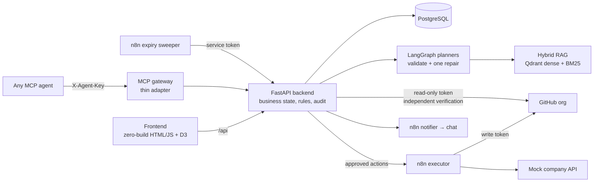

# LivingOps AI

**The operating layer for hybrid human + AI workforces. Every access has an owner, a policy reason, an expiry, and proof.**

People and AI agents go through the same governed lifecycle: onboarding, access requests, sponsor changes, offboarding. An LLM reads the company's own policies and drafts plans that cite them; deterministic rules and humans approve; n8n executes only approved actions, including on a real GitHub organization; the backend verifies the result itself; everything is audited. When a policy changes, **Policy Guardian** finds every plan, learned lesson and live agent access that now breaks it, and proposes the fix.

Built for the International AI Builders Congress 2026, InfraSphere AI track (WorkforceOS + AgentOps). Nexora Labs and everyone in it are fictional.

## The story the demo tells

1. **Problem.** A live map of Nexora Labs: about 85 people and 24 AI agents, joined by who sponsors which agent. Some agents are already orphaned.
2. **Arif Hossain leaves.** HR opens his offboarding. The AI drafts the plan from policy: disable email, revoke GitHub, return the laptop, reassign work, and decide what happens to his two agents. Every step shows *why*: the policy clause it cites.
3. **Manager correction.** Nabil keeps Aurora Release Bot but makes its deploy key read-only. The correction becomes an approved lesson.
4. **Execution and proof.** n8n runs each approved action; the backend checks GitHub with its own read-only token before anything counts as verified. A stopwatch shows termination-to-all-access-closed time.
5. **The bot asks for access.** Over MCP, the bot asks for two hours of write access. Rules mark it HIGH risk, the IT Owner approves, access expires on its own. A low-risk read request is approved automatically.
6. **Policy changes.** Access Policy V2 lands. Guardian flags the bot's live write access and the lesson; one approval downscopes the key.
7. **Proof and quality.** One-click ISO 27001 evidence report; an evaluation panel with real numbers.

## Architecture



**Boundaries that never move**

- The LLM never writes to the database or the vector store and never executes anything. It retrieves policy, drafts plans with evidence IDs, and writes explanations.
- Risk tiers, orphan detection, plan validation and Guardian impact detection are deterministic rules. The same input gives the same result.
- An action is `VERIFIED` only after the backend checks the external system itself, never because n8n said so.
- Synchronous Python modular monolith; no queues, no WebSockets. The frontend polls.

## Run it

### Option A: one command with Docker (local, OFFLINE by default)

```bash
docker compose up --build
```

Frontend http://localhost:5173 · API http://localhost:8000/docs · MCP http://localhost:8765/mcp. It starts its own Postgres and Qdrant, migrates, seeds the policies and the company, and runs on recorded AI answers (`DEMO_MODE=OFFLINE`). For live AI, set `DEMO_MODE=LIVE` and your keys in `.env`.

### Option B: Python on Windows (the development setup)

```powershell
python -m venv newenv; newenv\Scripts\activate
pip install -r backend/requirements.txt -r mcp_server/requirements.txt
copy .env.example .env   # then fill in your own values; never commit .env
cd backend
python -m app.scripts.bootstrap          # schema, vector index, policies, company
python -m uvicorn app.main:app --reload  # API on :8000
cd ..\frontend; python serve_frontend.py # UI on :5173
python -m mcp_server                     # optional: MCP gateway on :8765 (from the project root)
```

Reset between rehearsals (cases, approvals, lessons, policies back to V1):

```powershell
cd backend; python -m app.scripts.reset_demo --yes
```

## Demo modes

| Mode | AI | Execution |
| --- | --- | --- |
| `LIVE` | OpenAI, every answer recorded | n8n + real GitHub |
| `CACHED_AI` | recorded answers first | n8n + real GitHub |
| `OFFLINE` | recorded answers only | in-process mock executor |

The badge at the top of every page shows the mode. Every scene gives the same result in all three.

## Characters

| Person | Role |
| --- | --- |
| Farhana Islam | HR Manager, opens the offboarding |
| Nabil Chowdhury | Engineering Manager, corrects the plan, new sponsor of the bot |
| Tahmid Hasan | IT Security Owner, approves agent access and remediation |
| Arif Hossain | Senior Software Engineer, leaving; sponsor of Aurora Release Bot |
| Amina Rahman, Rafi Ahmed | New AI Engineers (onboarding) |

Switch who you are with "Acting as" at the top of each page.

## Repository

| Path | What |
| --- | --- |
| `backend/` | FastAPI app, LangGraph planners, rules, Guardian, MCP backend, evidence, evaluation, Alembic migrations, tests |
| `frontend/` | Dashboard map, Workspace, Approvals, Guardian, Cases, Security |
| `mcp_server/` | MCP Access Gateway (Streamable HTTP) and the scripted demo client |
| `n8n/` | Executor, notifier and expiry-sweeper workflows (no credentials) |
| `data/seed/` | Policies (ACCESS V1/V2, AGENT, EQUIPMENT, OFFBOARDING) and resource catalog |
| `data/demo_cache/` | Recorded AI answers and embeddings for CACHED_AI / OFFLINE |
| `docs/` | Final plan, decision log, original plan book, handoff |

## Tests

```powershell
cd backend; python -m pytest -q
```

Unit tests need no database or API keys. `python -m app.scripts.rehearse_hero` runs scenes 2–4 end to end against the configured services, and `python -m app.scripts.run_evaluation` produces the evaluation panel numbers.

## Honest limits

- Only GitHub is a real external system; email, laptops, training and work items are a mock company API behind the same connector interface.
- KPIs are measured on the fictional demo company and labelled as a simulated operational comparison, not customer results.
- The anomaly model (Isolation Forest on SPEDIA) is a small Security-page feature; its precision is not claimed.
- The ISO 27001 report is supporting evidence for an auditor, not a certification.
- Pricing on the business slide is a hypothesis.

## Sources for the problem statement

Market numbers used in the pitch, with sources and caveats (most surveys are vendor-funded), are listed in [`docs/CONTEXT.md`](docs/CONTEXT.md) §5.
